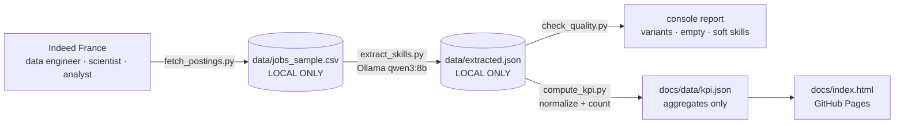

# Skills in data job postings — scraping to KPI

**TD3 · Business Intelligence** — raw scraped text turned into a number that can be
defended in a report: acquire → structure with a local LLM → check quality →
define a KPI → publish only what is safe → visualize for a decision.

### [Open the dashboard](https://adam-hassen-bi.github.io/td-scraping-to-kpi-TD3/)

https://adam-hassen-bi.github.io/td-scraping-to-kpi-TD3/

> **The decision it supports:** ENSIM's curriculum committee asks *which skills do
> data job postings actually ask for, and what should students learn next?*

---

## How it works



| Stage | What happens | Where |
|---|---|---|
| **Acquisition** | `scrape_demo.py`: robots.txt checked with `requests` + `rp.parse()` (not `rp.read()`, which silently says "disallow" behind a proxy), then one Wikipedia page → one variable. `fetch_postings.py`: 15 real postings with python-jobspy | `scripts/` |
| **Structuring** | Each description (first 1,500 chars) sent to a **local** LLM that returns a JSON list of hard skills; `"think": false` keeps qwen3 at ~2 s per call | `extract_skills.py` |
| **Data quality** | Spelling variants (`Python` / `python`), postings with no skill, soft skills and job titles the prompt asked to exclude | `check_quality.py`, `skills.py` |
| **KPI** | Two KPIs from normalized skills, whole-skill match | `compute_kpi.py` |
| **Publication** | Only counts leave the laptop; postings and per-posting extractions are git-ignored | `.gitignore`, `docs/data/kpi.json` |
| **Visualization** | Dashboard for the curriculum committee | `docs/index.html` |

No GitHub Action on purpose: a GitHub runner has no GPU, so the LLM step runs on
the laptop, once, and the aggregate is pushed by hand.

## The KPIs

| KPI | Definition |
|---|---|
| **Postings asking for a skill** (default Python, any skill selectable on the page) | share of postings whose normalized skill list contains that skill |
| **Postings asking for a cloud provider** | share of postings mentioning at least one of AWS, Azure, GCP |

Two corrections over the TD's starting `compute_kpi.py`, both visible on the page:

- **Normalization before counting** (`skills.py`): lower-case, trimmed, aliases
  (`PowerBI` → `Power BI`, `Google Cloud` → `GCP`…), each skill counted once per
  posting, soft skills / spoken languages / job titles removed.
- **Whole-skill match instead of substring**: with `target in skill`, "r" matches
  Docker, Spark and PowerBI. On the synthetic 15-posting set used to test the script, the substring version gives
  **87 %** of postings "asking for R" against **7 %** for the corrected one. The
  naive value is still published next to the corrected one.

Every share is shown with its **95 % confidence interval** (Wilson): with 15 postings,
one posting moves a share by 7 points.

## What is published — and what is not

| File | In git? | Why |
|---|---|---|
| `data/jobs_sample.csv` | **no** (`.gitignore`, added before any data existed) | scraped postings; Indeed's terms forbid redistribution |
| `data/extracted.json` | **no** | per-posting titles, companies and skill lists |
| `docs/data/kpi.json` | yes | counts per skill, the KPIs, quality counters, model name — no title, company, text or per-posting row |

## Run it on your own machine

Needs [Ollama](https://ollama.com) running with `qwen3:8b` (`ollama pull qwen3:8b`).

```bash
git clone git@github.com:adam-hassen-Bi/td-scraping-to-kpi-TD3.git
cd td-scraping-to-kpi-TD3
./run_all.sh               # fetch 15 postings, extract, check quality, compute KPIs
python3 serve.py           # dashboard on http://localhost:8000
```

`run_all.sh` ends with `git status` so you can check the scraped files are not
tracked. Step by step instead:

```bash
python3 -m pip install --user requests beautifulsoup4 uv
python3 scripts/scrape_demo.py                 # optional: robots.txt + one extraction
python3 -m uv run scripts/fetch_postings.py 15 # python-jobspy needs Python 3.10+, uv provides it
python3 scripts/extract_skills.py 15
python3 scripts/check_quality.py
python3 scripts/compute_kpi.py --skill sql     # any skill for KPI 1
```

## Repository layout

```
scripts/scrape_demo.py      robots.txt check + one real HTML extraction
scripts/fetch_postings.py   real postings from Indeed France (local only)
scripts/extract_skills.py   local LLM: free text -> list of skills
scripts/skills.py           normalization rules shared by the next two
scripts/check_quality.py    data-quality report on the raw extraction
scripts/compute_kpi.py      the two KPIs -> docs/data/kpi.json
docs/index.html             dashboard (GitHub Pages source)
run_all.sh · serve.py       run the pipeline · preview the dashboard
REFLECTIONS.md              answers to the 9 TD questions
```

## Limits

- 12–15 postings from one job board on one day: a pilot, not a market study.
- The LLM can miss a skill or invent one; the raw extraction is cross-checked by a
  classmate (critique pass), not only by the script.
- "Mentioned" is not "required at a given level": the KPI says nothing about depth.
- The alias table only merges variants that have been seen; a new spelling stays
  separate until `check_quality.py` reports it and it is added.
